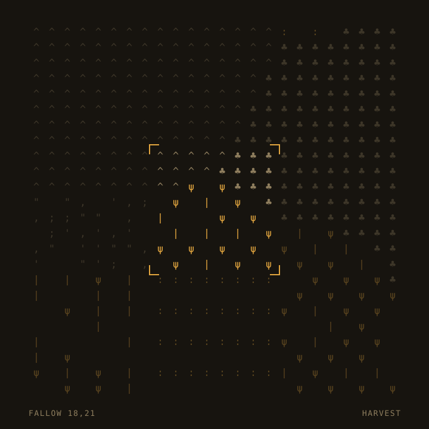
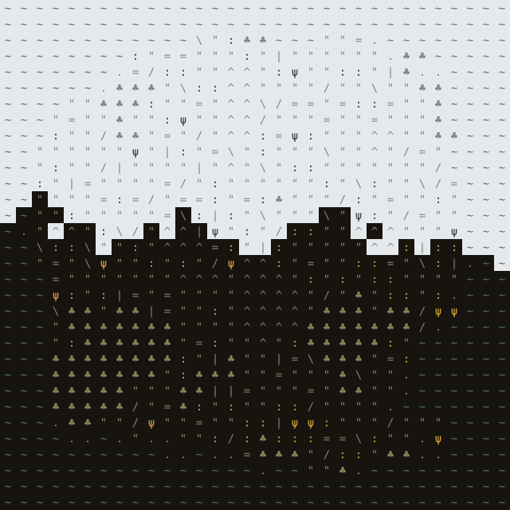

# Fallow

A minimalist, fully onchain land NFT. 1,024 parcels on a 32×32 island, drawn in text glyphs. You have one verb, `tend()`, and you can use it once a day. Land you stop tending goes back to wild.

<p>
  
  
</p>

Every image in `renders/` was produced by the contracts themselves after a simulated two months of tending (`npm run render`).

## How it works

**The island.** Terrain isn't stored anywhere. Each of the 256×256 cells is computed from a seed with fixed-point Perlin noise and pulled down toward the edges, so the field is always an island. Height bands turn it into sea, shore, meadow, wood and rock. The approach follows 0xPARC's [On-chain Procedural Generation](https://0xparc.org/blog/procgen).

**Parcels.** Token IDs are coordinates (`id = y * 32 + x`). With the default seed, 649 parcels are land and 375 are sea. Sea plots can be owned but not farmed.

**Tending.** `tend()` moves a parcel one stage forward: wild → tilled → sown → harvest → tilled … You can tend once per UTC day, and only as the owner. After 30 days untended, the parcel reads as wild again. That's computed on read, so nothing has to happen onchain for land to go wild.

**Streak and loam.** Tending on consecutive days builds a streak. Each tend adds loam, a hidden XP tally modeled on Corruption(\*s)'s insight: +1 per tend, plus +1 for each full week of streak. A missed day breaks the streak, and the streak reads as 0 even before anyone touches storage. Loam never goes down. Selling or transferring a parcel resets its streak but keeps its loam.

**What you see.** A token shows its parcel lit and its eight neighbors dimmed, so part of how your land looks depends on who lives next door.
- Each parcel's furrows run east–west, north–south or along one of the diagonals, fixed by its hash, so neighboring farms read as a quilt.
- Harvests ripen unevenly. Loam decides how much of the crop is ripe (`ψ`) and how much is still growing (`|`). Loam never appears as a number in the image, only in the traits.

**Seasons.** Each season has a 4-color palette (background, ink, water, accent). Seasons turn on Mar 1, Jun 1, Sep 1 and Dec 1. Each change sweeps from the north shore south at about 1.5 parcel rows a day, along a front that weather noise makes uneven.

## Contracts

- **`FallowTerrain`** is the island. It's immutable. Its constructor computes all 1,024 parcel types once from the formula and stores them, so `isSea()` is cheap and can't disagree with the math. `cells()` computes any block of cells for the renderer.
- **`Fallow`** is the ERC-721: mint by coordinate, `tend()`, decay, streak, loam, and transfer resets. It emits ERC-4906 `MetadataUpdate` on every tend.
- **`FallowRenderer`** builds the SVG and JSON entirely onchain: the token view, the full-island `mapSvg(day)`, and seasons. The owner can swap it until `lockRenderer()` is called, which is one-way.

`reference/terrain.js` mirrors the terrain math exactly. The tests check the two agree cell for cell.

## Gas

Measured on the local chain:

- Terrain deploy: 10.1M
- `tend()`: about 59k
- `tokenURI`: 11.5M
- `mapSvg`: 8.5M

All of these are under the 16.7M per-transaction cap (EIP-7825). The local chain is configured to enforce that cap on every call, so a render that grows past it fails the tests.

## Quickstart

```bash
npm install
npm test             # mechanics, terrain parity, render gas
npm run render       # simulate ~2 months of tending, write SVGs to renders/
npm run calibrate    # thresholds + ASCII preview of the island for a seed
RPC_URL=… PRIVATE_KEY=… npx hardhat run scripts/deploy.js --network live   # optional: FALLOW_SEED, FALLOW_PRICE_ETH
```

No internet access for the compiler download? Prefix any command with `LOCAL_SOLCJS=1` to compile with the bundled solcjs instead.

To try a different island, run `npm run calibrate -- "some seed"` to preview it, then deploy with `FALLOW_SEED="some seed"`. The deploy script recalibrates the thresholds for the new seed.

## Open questions

- **Mint.** Right now minting is first come, first served by coordinate, at a fixed price set at deploy (0 by default). An allowlist, an auction, or one parcel per wallet would all be small changes.
- **Sea plots.** They're currently owned but not farmable. They could be excluded from minting instead, or get a verb of their own (fishing, tides).
- **Chain.** A daily `tend()` costs about 59k gas. That's fine on L1 when fees are low and trivial on an L2.
- **Marketplace caching.** Decay and season sweeps change the image without a transaction, so no event fires. A daily `BatchMetadataUpdate` from a keeper (or anyone) would keep marketplaces current.
- **ERC-8048 / ERC-8493.** OpenSea's beta reads `onchain:` URIs from a `metadata(tokenId, key)` getter. The renderer could serve the raw SVG through that later. For now `tokenURI` returns a data URI, which works on every marketplace.
- **Render headroom.** `tokenURI` sits at about 70% of the cap. Writing the SVG into one preallocated buffer would cut that substantially if the art grows.
- **License.** Code is marked `UNLICENSED` until you choose one.

## Layout

```
contracts/
  Fallow.sol            game + ERC-721
  FallowTerrain.sol     island (Perlin, falloff, parcel table)
  FallowRenderer.sol    SVG + JSON, seasons
  test/GasProbe.sol     test helper: single-execution gas measurement
reference/terrain.js    exact JS mirror of the terrain math
scripts/                deploy, calibrate, render
test/                   mechanics + parity tests, render tests
renders/                SVGs produced by the contracts (open index.html)
```

Credits: the procgen approach follows 0xPARC's essay (Nalin and gubsheep). The hidden XP tally and the streak reset on transfer are modeled on Dom Hofmann's Corruption(\*s).
